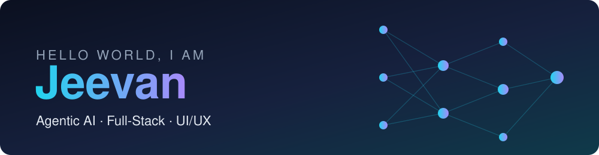

  

  
  
  

## About me

I'm a 3rd-year **AI & ML Engineering** student at **Dayananda Sagar College of Engineering, Bengaluru** (CGPA 9.29, graduating 2028). I like turning ideas into working products, from small models trained from scratch to full-stack apps, and I take part in a lot of hackathons.

> **Now building:** offline-first RAG and tiny language models for log analysis
> **Now learning:** agentic workflows and deep learning
> **Also:** LeetCode every week, UI/UX design, and videos on my YouTube channel
> **Open to:** AI / GenAI internships and hackathon teammates

---

## Featured Projects

<table>
  <tr>
    <td width="50%" valign="top">
      <h3><a href="https://github.com/Jeevan-33/local-rag-assistant">Local RAG Study Assistant</a></h3>
      <i>Chat with your own notes, fully offline.</i>  
      Indexes your PDFs/notes and answers with BM25 + dense + hybrid retrieval, chosen after a controlled experiment on 150 labeled questions (<b>86.7% top-1</b>). No cloud, no API costs.  
      <b>Stack:</b> Python · Ollama · BM25 · embeddings
    </td>
    <td width="50%" valign="top">
      <h3><a href="https://github.com/Jeevan-33/llms_for_log_analysis">LogLM-Lite</a></h3>
      <i>A tiny transformer that knows when to ask for help.</i>  
      Small transformer trained from scratch to classify Hadoop log events and detect BGL anomalies, routing uncertain messages to an LLM. Leak-free split, baselines, ablations, 46 tests.  
      <b>Stack:</b> Python · Transformers · LLM routing
    </td>
  </tr>
  <tr>
    <td width="50%" valign="top">
      <h3><a href="https://github.com/Jeevan-33/ai-resume-job-matcher">JobMatcher.io</a></h3>
      <i>From resume to a plan for closing the skill gap.</i>  
      Parses a resume, scores it against real job postings and generates a resource-backed plan for the remaining skill gap.  
      <b>Stack:</b> FastAPI · PostgreSQL · React
    </td>
    <td width="50%" valign="top">
      <h3><a href="https://github.com/Jeevan-33/Ai_Predictive_Maintainance">Orbital Foundry</a></h3>
      <i>Self-evolving predictive maintenance.</i>  
      Real-time anomaly detection for industrial machines (Z-score, Isolation Forest, trend scoring) with a monitoring agent and live dashboard.  
      <b>Stack:</b> FastAPI · React · Streamlit · Express · <a href="https://ai-predictive-maintainance.vercel.app">Live demo</a>
    </td>
  </tr>
  <tr>
    <td width="50%" valign="top">
      <h3><a href="https://github.com/Jeevan-33/wanderplan-app">WanderPlan</a></h3>
      <i>Smart travel planner for Android.</i>  
      Dark-themed app with expandable day-by-day itineraries, Google Maps route polylines and local SQLite storage.  
      <b>Stack:</b> Java · Android · Google Maps · SQLite
    </td>
    <td width="50%" valign="top">
      <h3><a href="https://github.com/Jeevan-33/MiniProjectTracker">AIML Project Tracker</a></h3>
      <i>Project lifecycle for a department.</i>  
      Manages batches, semesters, teams, guides and review marks, with role-based views and an AI chatbot to search projects in plain English.  
      <b>Stack:</b> Full-stack · <a href="https://mini-project-tracker-henna.vercel.app">Live demo</a>
    </td>
  </tr>
</table>

<b>More projects</b>

 

| Project | What it is |
|---|---|
| [wellness-planner](https://github.com/Jeevan-33/wellness-planner) | Constraint-based wellness agent that plans routines around time, energy and mental load |
| [Lan-Chat](https://github.com/Jeevan-33/Lan-Chat) | Real-time chat over LAN with Flask + Socket.IO, no internet needed |
| [GrowGuide](https://github.com/Jeevan-33/GrowGuide) | AI-powered crop recommendation and price forecast web app |
| [house-price-prediction-ml](https://github.com/Jeevan-33/house-price-prediction-ml) | Feature engineering + ML regression |
| [Classification_Benchmark_on_titanic_dataset](https://github.com/Jeevan-33/Classification_Benchmark_on_titanic_dataset) | Classifier benchmarking, Kaggle-style |
| [Air-Quality-PowerBI](https://github.com/Jeevan-33/Air-Quality-PowerBI) | Power BI air quality dashboard |
| [Library-Management-Automation-UiPath](https://github.com/Jeevan-33/Library-Management-Automation-UiPath) | RPA automation with UiPath Studio |
| [JeevOS](https://github.com/Jeevan-33/JeevOS) · [jm-motors](https://github.com/Jeevan-33/jm-motors) · [student-manager](https://github.com/Jeevan-33/student-manager) | Other JavaScript / Python builds |

---

## Tech I work with

**Languages** &nbsp;

**AI / ML** &nbsp;

**Web & Data** &nbsp;

**Design & Tools** &nbsp;

---

## By the numbers

  
  
  
  

  

---

## Let's connect

Reach me on [LinkedIn](https://www.linkedin.com/in/jeevan-ae/) or through my [YouTube channel](https://youtube.com/@thetechodysseyyt). Always up for collaborating on AI projects and hackathons.
